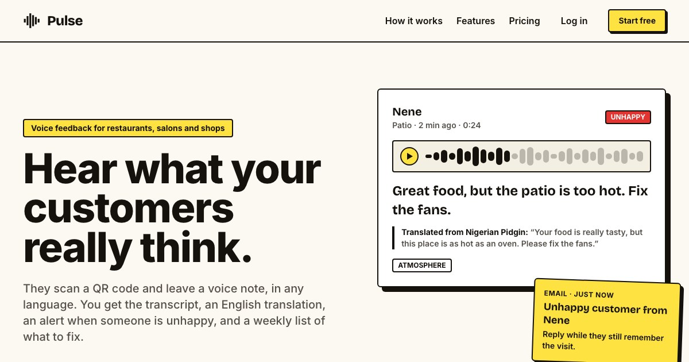

# Pulse

Voice feedback for businesses. Customers scan a QR code and record up to two minutes in any language. Owners get a transcript, an English translation, a one-line summary, themes, sentiment, an alert for negative feedback and a weekly digest of what to fix.

Live at [pulseapp.click](https://www.pulseapp.click).

[](https://youtu.be/n0NAYKywunA)

The image links to a 36-second walkthrough.

## What it does

**For the customer**, a page at `/f/<business code>`:
- record in the browser (no app or account), listen back, re-record, send;
- the recording stops on its own at 2 minutes;
- the page says so when the business is out of credit, instead of failing after the recording;
- if the microphone is refused or the browser can't record, the customer can type instead; typed feedback is labelled as typed for the owner.

**For the owner**, a dashboard at `/dashboard`:
- every recording with playback, a summary, themes, a sentiment tag and, for non-English recordings, the English translation next to the original;
- filters by sentiment and by spot;
- **Branding** (`/settings`): the question on the feedback page, a logo, an accent colour, a thank-you message and a Google review link;
- **Spots**: extra QR codes for a branch, a table or an event (`/f/<code>?spot=<slug>`), each tagging its feedback;
- **Insights** (`/dashboard?tab=insights`): sentiment over the last 30 days against the 30 before, and themes ranked by how often they come up negative;
- **Weekly digest**: up to three things to fix, each with a customer quote and a count, emailed on Mondays; the owner can also rewrite this week's so far from the Insights tab (3 times a day).

**Replies**: a customer can leave an email address after recording. The owner can send one reply from the feedback page; Pulse emails it from the business name and the address stays hidden from the owner unless the customer writes back. Addresses aren't verified, so replies are limited to 20 a day per business (see `src/server/replies.ts`).

**Printing**: `/print` lays out table tents (one A4 sheet, folded) and sticker sheets (6 per A4) for the main QR code or any spot, ready for the browser's "Save as PDF".

**Your data** (`/settings`): export everything as JSON, delete any piece of feedback, or delete the whole account and every stored file. Recordings are deleted automatically after 12 months; transcripts stay. Reply addresses are forgotten within a day of the reply, or after 90 days. `/privacy` lists every service Pulse uses; `/dpa` is a template data processing agreement for business customers.

**Emails** to the owner:
- each new recording; negative ones arrive as an "Unhappy customer" alert with the summary;
- a low-balance warning when credit drops to 9, 4 and 0;
- the Monday digest.

**Credit**: one recording spends one pulse. New accounts get 5. Owners buy packs of 10, 25, 50 or 100, or a custom amount from 5 to 500 priced at the matching pack rate, through Polar.

## Run it locally

Needs [Bun](https://bun.sh), Postgres, and keys for ElevenLabs, OpenAI or OpenRouter, Cloudflare R2 and Resend. Polar keys are only needed to test buying credit.

```bash
bun install
cp .env.example .env.local   # then fill it in, see below
DATABASE_URL=postgres://… bun run db:migrate
bun run dev                  # http://localhost:3000
```

Sign in at `/login` with any email. With `EMAIL_DELIVERY=log` the login code is printed in the dev server output instead of emailed.

What a local run touches:
- **Postgres** at `DATABASE_URL`.
- **R2**: recordings are uploaded to the bucket under `dev/` when `NODE_ENV` is not `production`.
- **ElevenLabs and OpenAI/OpenRouter**: one transcription and one analysis call per recording, billed to your keys.
- **Resend**: real emails unless `EMAIL_DELIVERY=log`. Use `log` for development; each test run otherwise sends several.

## Environment variables

All are read and validated in `src/env.ts`. `.env.example` lists them with placeholders.

| Variable | Needed for |
| --- | --- |
| `DATABASE_URL` | Everything |
| `SESSION_SECRET` | Sign-in cookies. At least 32 characters; the app refuses to start otherwise |
| `SERVER_URL` | Links in emails, Polar redirects and QR codes, e.g. `http://localhost:3000` |
| `ELEVEN_LABS_API_KEY` | Transcription |
| `OPENAI_API_KEY`, `OPENROUTER_API_KEY` | Analysis and digests. OpenAI is tried first; OpenRouter runs the same model if it fails. One is enough |
| `CLOUDFLARE_ACCOUNT_ID`, `CLOUDFLARE_ACCESS_KEY_ID`, `CLOUDFLARE_SECRET_ACCESS_KEY`, `CLOUDFLARE_R2_BUCKET_NAME` | Audio storage |
| `SERVER_RESEND_API_KEY` | Email |
| `EMAIL_DELIVERY` | `send` (default) or `log` to print emails instead |
| `RESEND_WEBHOOK_SECRET` | Forwarding inbound email to the owner of the app |
| `POLAR_ENVIRONMENT` | `production` (default) or `sandbox` |
| `POLAR_API_KEY`, `POLAR_WEBHOOK_SECRET` | Payments in production |
| `POLAR_SANDBOX_API_TOKEN`, `POLAR_SANDBOX_WEBHOOK_SECRET` | Payments in the Polar sandbox |
| `CRON_SECRET` | The weekly digest and retention crons. Without it both cron routes answer 401 |
| `NEXT_PUBLIC_APP_URL`, `NEXT_PUBLIC_APP_TITLE` | Fallbacks for client-side links and the page title |

## Tests

```bash
bun run test        # Vitest: unit and API tests
bun run test:e2e    # Playwright: browser journeys against a running app
```

**Vitest** runs against a real Postgres database, so locks, unique constraints and concurrent updates behave as they do in production. It defaults to `postgres://postgres@localhost:5440/pulse_test` (override with `TEST_DATABASE_URL`) and **empties that database before every test**. Create it once:

```bash
createdb -h localhost -p 5440 -U postgres pulse_test
DATABASE_URL=postgres://postgres@localhost:5440/pulse_test bun run db:migrate
```

External services (R2, ElevenLabs, the AI providers, Resend, Polar) are mocked in Vitest.

**Playwright** drives desktop Chrome and a Pixel 7 against the dev server (`PLAYWRIGHT_BASE_URL`, default `http://localhost:3000`). The services are real, so start the server with `EMAIL_DELIVERY=log`:

```bash
bunx playwright install chromium   # once
EMAIL_DELIVERY=log bun run dev
bun run test:e2e
```

- `journey.spec.ts`: sign up, brand the feedback page, add a spot, a customer records through the spot's link and asks for a reply, the real transcript and analysis arrive, playback, the owner replies, the spot filter, a customer with a blocked microphone types instead, running out of credit, the buy page, deleting feedback, exporting data and deleting the account.
- `insights.spec.ts`: the Insights charts, then the real model writes a digest.
- `print.spec.ts`: table tents and sticker sheets as A4 PDFs, including the longest question and a long business name.

The specs read login codes from the app's database (`E2E_DATABASE_URL`, default `postgres://postgres@localhost:5440/pulse_dev`). Chrome's fake microphone hangs on macOS without a system microphone grant, so the specs give the page a Web Audio stream of `tests/e2e/fixtures/feedback.wav` instead; the app still records it with `MediaRecorder` and uploads real audio.

## Scripts

| Command | Does |
| --- | --- |
| `bun run dev` | Dev server on port 3000 |
| `bun run build`, `bun run start` | Production build and server |
| `bun run db:generate` | New migration in `drizzle/` from `src/db/schema.ts` |
| `bun run db:migrate` | Apply migrations to `DATABASE_URL` |
| `bun run db:studio` | Drizzle Studio |
| `bun run lint`, `bun run check` | ESLint; Prettier then ESLint with fixes |
| `bun run dev:tunnel` | Public ngrok URL for the local app, for Polar webhooks |

## Deploying

Pulse runs on Vercel. Before deploying a change that adds a migration, apply it to the production database with `bun run db:migrate`.

`vercel.json` schedules two crons, both authorised by `CRON_SECRET`:

- the weekly digest at 08:00 and 14:00 UTC on Mondays. The second run picks up anyone the first missed; nobody is emailed twice.
- the retention clean-up daily at 03:00 UTC (`src/server/account-data.ts`). If a stored file can't be deleted (an R2 outage), the row is still cleared and the failure is logged; the file is not retried.

Polar sends `order.paid` and `order.refunded` to `/api/webhook/polar`.

<details>
<summary>How it works</summary>

**Stack**: Next.js 16 (App Router) with an [Elysia](https://elysiajs.com) API mounted at `app/api/[[...slugs]]/route.ts`, Drizzle on Postgres (Neon in production), Tailwind with shadcn components, TanStack Query, jose session cookies.

**Recording a piece of feedback** (`src/server/feedback-submission.ts`):
1. The browser uploads one file with `MediaRecorder` (mp4 on Safari, webm on Chrome, ogg on Firefox).
2. The server checks type and size (8 MB), spends one pulse with a single `update … where pulses_remaining > 0`, uploads to R2 under a server-made key and stores the row as `processing`. If the upload fails the pulse is returned.
3. It replies, then transcribes and analyses with Next's `after()`. ElevenLabs detects the language. One structured AI call returns sentiment, name, language, English translation, summary and themes. The transcript is kept even if analysis fails.
4. Viewing a recording with no transcript retries it, at most 3 times; a run stuck in `processing` for 10 minutes is taken over.

Submissions are rate limited per connection and per business (`src/server/rate-limit.ts`).

**Payments** (`src/server/billing.ts`): checkout is created on the server with the price from `src/lib/pricing.ts`; the browser never sends a price. The webhook credits each Polar order exactly once (unique order id, one SQL statement) and removes refunded pulses pro rata to the pre-tax amount.

**Sign-in** (`app/actions/auth.ts`): 6-digit codes from `crypto.randomInt`, valid 10 minutes, at most 5 guesses each (counted atomically), codes rate limited per email and per IP.

**Weekly digest** (`src/server/digest.ts`): each owner's week is claimed with a row in `weekly_digests` before any work. Retries resend the stored digest under the same Resend idempotency key, so a send is never duplicated.

</details>

## License

Private. All rights reserved.
